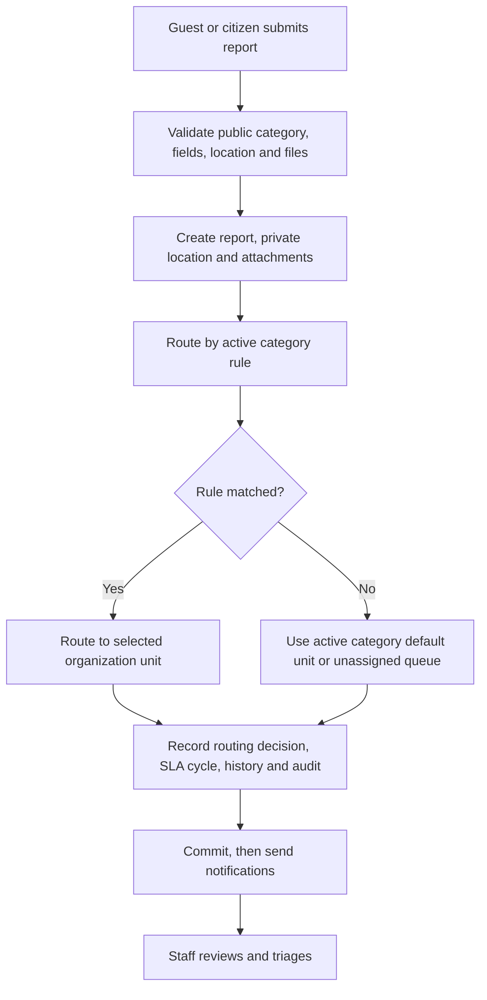

# CivicTrack 3.0 Architecture and Delivery Record

**Reviewed:** 2026-11-23  
**Status:** Core application workflows implemented; production setup and further hardening remain.  
**Application shape:** Laravel modular monolith, Blade application, one relational data store.

This record replaces the initial proposal with the architecture now present in the codebase. Automated feature tests use SQLite `:memory:`; they do not migrate or seed the configured application database. The existing `.env` and its credentials are intentionally left untouched. `.env.example` documents safe configuration defaults.

## 1. Runtime and package baseline

The project runs with the portable PHP **8.5.13** runtime and Laravel **13.43.0**. The machine's XAMPP PHP is not the runtime used for project Artisan, Composer, or tests. The configured production database version has not been confirmed; choose a currently maintained MySQL or MariaDB release before deployment.

| Package | Installed version | Use |
|---|---:|---|
| `laravel/framework` | 13.43.0 | Routing, HTTP, Eloquent, queues, notifications, scheduler, policies |
| `laravel/fortify` | 1.43.0 | Session authentication, verification, reset, profile and two-factor flows |
| `spatie/laravel-permission` | 8.5.0 | Role and permission persistence |
| `livewire/livewire` | 4.4.9 | Installed; current screens use Blade controllers and small JavaScript modules |
| `leaflet` | 1.9.4 range in `package.json` | Interactive report location picker and public community map |
| `tailwindcss` | 4.x | Design tokens and utility styling through Vite |
| `vite` | 8.x | Frontend development and production asset build |
| `phpunit/phpunit` | 12.5.45 | Feature workflow tests |

Confirm exact locked JavaScript versions in `package-lock.json` when changing frontend dependencies. Existing packages were selected for this foundation; any new dependency requires review first.

## 2. Application architecture

CivicTrack is a server-rendered modular monolith. Controllers are grouped by access context under `app/Http/Controllers`; Form Requests validate input and authorize entry; Policies and service-level checks enforce record and organization scope; focused services own transactional state changes. Eloquent models express the schema and relationships. Events and listeners deliver after-commit notifications, while queued jobs and the scheduler handle SLA escalation.

```text
app/
  Console/Commands/       # administrator bootstrap and SLA check
  Enums/                  # persisted roles, permissions, and workflow states
  Events/, Listeners/     # after-commit lifecycle notifications
  Http/Controllers/       # Public, Citizen, Staff, Worker, Admin, Account
  Http/Requests/           # validated and authorized inputs
  Jobs/, Notifications/   # queued escalation and user notices
  Models/                 # Eloquent entities and relationships
  Policies/                # report, unit, application, work order, and task access
  Services/                # routing and transactional workflows
database/migrations/       # application, Laravel, and permission schema
resources/views/           # separate role layouts and Blade screens
resources/js/app.js        # Leaflet map and work-order task interactions
routes/web.php             # browser routes and middleware boundaries
routes/console.php         # five-minute SLA schedule
```

There is no public API or mobile client in this delivery. A future API must use explicit versioned routes and the same policies and workflow services.

## 3. Access contexts and organization scope

One verified web account can retain citizen access and separately gain a workforce role. Guest citizens use signed-in-session-free report access codes. Staff and workers are separate persisted roles with separate dashboards and permission sets. Pending applicants receive no operational role.

| Context | Current authorization boundary |
|---|---|
| Guest citizen | Submit a report, then use its random access code to see permitted public history, comment, send eligible feedback, or request reopening. The database stores only the SHA-256 token hash and expiry. |
| Registered citizen | Create and view own reports, post permitted comments, receive account notifications, and use eligible service feedback. Ownership is checked for every report operation. |
| Staff | Active staff membership in the report or work-order unit is required for departmental work. Staff triage, plan tasks, assign workers, review evidence, verify work, review reopen requests, and rate completed assignments. |
| Field worker | May view and update only assigned tasks, submit evidence, and request verification. Workers cannot verify their own work or access staff report functions. |
| Administrator | `platform.access` plus named permissions permits cross-unit administration. Configuration and approval changes are audited. |

Roles and permissions are seeded from `RoleName` and `PermissionName`. Laravel policies and scoped queries remain required; a role name alone does not grant cross-unit record access. Organization units form a parent/child tree. `unit_memberships` preserve membership type, active state, and dates. Approved applications create a staff/worker profile, role, and unit membership in one review transaction. The admin bootstrap command creates a configured administrator only when that identity does not exist; it does not overwrite an existing password.

## 4. Database relationship design

The ER diagram reflects persisted application entities. Laravel sessions, cache, queue tables, database notifications, and Spatie permission tables support the application but are not repeated in the diagram.

```mermaid
erDiagram
    USERS ||--o| CITIZEN_PROFILES : has
    USERS ||--o| STAFF_PROFILES : approved_as
    USERS ||--o| WORKER_PROFILES : approved_as
    USERS ||--o{ WORKFORCE_APPLICATIONS : submits
    WORKFORCE_APPLICATIONS ||--o{ WORKFORCE_APPLICATION_EVENTS : records
    WORKFORCE_APPLICATIONS ||--o{ WORKFORCE_APPLICATION_DOCUMENTS : includes
    USERS ||--o{ UNIT_MEMBERSHIPS : joins
    ORGANIZATION_UNITS ||--o{ ORGANIZATION_UNITS : contains
    ORGANIZATION_UNITS ||--o{ UNIT_MEMBERSHIPS : includes

    ORGANIZATION_UNITS ||--o{ SERVICE_CATEGORIES : default_unit
    SERVICE_CATEGORIES ||--o{ SERVICE_CATEGORIES : parent
    SERVICE_CATEGORIES ||--o{ ROUTING_RULES : selects
    ORGANIZATION_UNITS ||--o{ ROUTING_RULES : receives
    USERS o|--o{ CIVIC_REPORTS : reports
    SERVICE_CATEGORIES ||--o{ CIVIC_REPORTS : classifies
    ORGANIZATION_UNITS o|--o{ CIVIC_REPORTS : routes
    USERS o|--o{ CIVIC_REPORTS : assigned_staff
    CIVIC_REPORTS ||--o| REPORT_LOCATIONS : locates
    CIVIC_REPORTS ||--o{ GUEST_ACCESS_TOKENS : grants
    CIVIC_REPORTS ||--o{ REPORT_STATUS_EVENTS : tracks
    CIVIC_REPORTS ||--o{ REPORT_COMMENTS : discusses
    CIVIC_REPORTS ||--o{ REPORT_ATTACHMENTS : supports
    CIVIC_REPORTS ||--o{ ROUTING_DECISIONS : records

    CIVIC_REPORTS ||--o{ WORK_ORDERS : creates
    ORGANIZATION_UNITS ||--o{ WORK_ORDERS : manages
    WORK_ORDERS ||--o{ WORK_TASKS : contains
    WORK_TASKS ||--o{ TASK_DEPENDENCIES : depends
    WORK_TASKS ||--o{ TASK_ASSIGNMENTS : assigns
    USERS ||--o{ TASK_ASSIGNMENTS : worker
    TASK_ASSIGNMENTS ||--o{ TASK_UPDATES : records
    TASK_ASSIGNMENTS ||--o{ TASK_EVIDENCE : submits
    TASK_ASSIGNMENTS ||--o{ TASK_VERIFICATIONS : reviewed
    TASK_ASSIGNMENTS ||--o| WORKER_RATINGS : rated

    REPORT_SLA_POLICIES o|--o{ REPORT_SLA_INSTANCES : snapshots
    CIVIC_REPORTS ||--o{ REPORT_SLA_INSTANCES : cycles
    REPORT_SLA_INSTANCES ||--o{ SLA_EVENTS : records
    CIVIC_REPORTS ||--o| SERVICE_FEEDBACK : receives
    CIVIC_REPORTS ||--o{ REPORT_REOPEN_REQUESTS : receives
    USERS o|--o{ AUDIT_EVENTS : acts
```



Important constraints and history records:

- A report has one location row, a unique public reference, an optional citizen owner, and a current routed unit. Status transitions, routing decisions, comments, and SLA events are separate records.
- A report may have multiple work orders and tasks. Task dependency pairs are unique and self-dependency is rejected; the work-order service rejects dependency cycles. Task evidence and verification point to the relevant assignment.
- A report has at most one service feedback row. A completed task assignment has at most one worker rating. A report may have multiple SLA cycles, uniquely numbered per report, and multiple reopen requests over its lifetime.
- SLA policy and name/version/target snapshots make existing report deadlines independent from future policy edits. No matching policy is represented as `not_applicable`, without invented deadlines.
- Guest tokens are stored as hashes. Guest email is encrypted at rest by an Eloquent cast. Private uploads use generated storage paths and are served through scoped download routes.
- `audit_events` store actor, polymorphic subject, action, properties, request metadata, and timestamp. Workflow history tables are append-only through application paths; administrative changes also write audit events.

## 5. Report submission and routing lifecycle

Registered citizens and guests share the same category, location, description, upload, routing, triage, and SLA handling. Public submission checks category availability again inside the transaction. Guest submissions receive an unguessable access code; the code is shown once and is required for protected tracking actions. Submission, initial status history, routing decision, SLA snapshot, token, and audit record are committed together. Uploads are removed if the database transaction fails.



The current routing engine chooses the highest-priority active rule for the category, then an active category default, then the unassigned triage queue. It records the reason and destination. Geographic polygons, service-area boundaries, keyword/AI classification, and configurable field schemas are not implemented; routing is category based.

Current report statuses are `submitted`, `under_review`, `needs_information`, `acknowledged`, `in_progress`, `resolved`, `closed`, `reopened`, `rejected`, and `duplicate`. Triage accepts submitted, under-review, or reopened reports and can move them into under-review, acknowledged, information-requested, rejected, or duplicate. Staff status and priority changes have an actor, reason where required, status history, and audit record. Acknowledged reports can move into field work; verified completion resolves a report only when every required task is verified. Rejected and duplicate outcomes close the associated SLA cycle.

## 6. Workforce application and task lifecycle

Staff and worker applications are separate application types and review permissions. Applicants can submit information and private documents, view their own application history, and answer information requests. Review decisions use a transaction to append an application event, record the reviewer, and—on approval—create the corresponding profile, active unit membership, and distinct `staff` or `worker` role. Rejection leaves no active operational membership. New applicants receive status notifications.

For an acknowledged report, authorized staff create one or more work orders containing tasks and dependencies. Each work order is scoped to the routed unit. Staff assign eligible active unit workers, subject to a configurable active-task limit. Workers accept or decline assignments, start work, append progress updates, upload evidence, and submit the task for review. Staff can verify completion or return it with a required correction reason. All state changes are transactional and audited. There are no worker skill/certification records, route optimization, shift calendars, or task-level SLA timers in this version.

Task states: `queued` → `assigned` → `in_progress` → `submitted_for_review` → `completed`, with `needs_rework` and `cancelled` paths. Assignment states independently track `assigned`, `accepted`, `in_progress`, `submitted`, `needs_rework`, `completed`, `declined`, and `reassigned`. A work order completes when its tasks are verified; a report resolves only when all its tasks across work orders are complete. The implementation caps task creation at 25 per work order.

## 7. SLA, notification, and scheduling architecture

Administrators maintain versioned report-SLA policies with optional category, unit, and priority scopes, effective/expiry dates, first-response and resolution targets, and repeat-escalation intervals. At submission, the service selects the most specific matching active policy, then the most recent version. The new SLA instance freezes the effective policy values. If none applies, it creates a truthful `not_applicable` cycle.

The first-response target is recorded at staff triage. Resolution is recorded when the report is closed without work or after all required work is verified. Reopening a resolved report starts a new numbered SLA cycle. A unique queued `EscalateReportSla` job locks the cycle, records newly breached targets and escalation history, audits the event, then queues notifications to active administrators and active staff in the routed unit. The job is idempotent under retry.

`civictrack:sla:check` is scheduled every five minutes with overlap prevention. Production must run Laravel's scheduler and a queue worker. The current `.env.example` uses database queues and log mail; mail delivery is not configured by this repository default. SLA durations currently use elapsed minutes; business-hour calendars, holidays, and unit-specific work schedules are not implemented.

Fortify and application events provide authentication and lifecycle notices. The account notification center lists the authenticated user's database notifications and supports marking one or all read. Notifications link to the appropriate report, workforce application, assigned task, or SLA queue. External SMS/push delivery and provider configuration are not included.

## 8. Feedback, reopening, mapping, and audit

After resolution, the report owner or guest with valid report access can leave one 1–5 service rating and optional comment. Within the configurable reopen window (default 30 days), that reporter may request reopening. Authorized staff in the routed unit approve or reject; rejection requires a reason. Approval records history and audit, returns the report to `reopened`, and starts a fresh SLA cycle. Staff may rate each completed and verified worker assignment once for quality, safety, and professionalism; self-rating and cross-unit rating are rejected.

Leaflet with OpenStreetMap tiles powers the report-location picker and public community map. Reports are private by default. Staff triage explicitly controls public listing. A published report receives rounded generalized coordinates and `generalized_public` privacy state; removing publication clears public coordinates. The map query requires both staff publication and generalized coordinates, allows only approved statuses, caps results at 500, and sends only category, status, and generalized coordinates to the browser. It never renders exact coordinates, address, report title, reference, contact details, or attachments. The default map center is `(0, 0)` and must be set for the deployment area. A production tile provider and its usage policy must be selected and configured for the expected traffic.

The admin audit view supports filtering by action, actor, and date. Workflow services use `AuditWriter` inside the transaction that changes state. Audit records include request metadata; access is limited to the audit permission. Citizen, staff, worker, and admin layouts are separate, and their dashboards use database queries for reports, workload, applications, SLA state, reopen queue, and ratings.

## 9. Design system and user experiences

The interface uses a shared tokenized Tailwind palette, typography scale, spacing, focus states, buttons, forms, badges, and card treatments. Blade layouts separate public, citizen, staff, worker, administrator, and authentication experiences. Public pages focus on service discovery, privacy, report submission, and transparent published activity. Citizen pages focus on their reports and updates. Staff pages focus on triage queues, workload, SLA, and work planning. Worker pages focus on assigned tasks, updates, and evidence. Administrator pages focus on configuration, applications, audit, and cross-service measures.

Leaflet controls are keyboard-accessible around the map and retain direct form fields for coordinates. Automated tests cover server-side privacy and workflow boundaries. A formal screen-reader, keyboard-only, contrast, and real-device review is still required before public launch.

## 10. Implementation phases and current acceptance evidence

| Phase | Delivered scope | Current evidence |
|---|---|---|
| 1. Foundation and identity | Laravel 13, Fortify, roles/permissions, account lifecycle, registration controls, safe admin bootstrap | Auth, registration, suspension, and bootstrap feature tests |
| 2. Organization and workforce | Unit hierarchy, staff/worker applications, scoped memberships, private application documents | Application and organization feature tests |
| 3. Citizen reports | Guest/citizen intake, private uploads, tracking token, routing, triage, comments and history | Report submission and triage feature tests |
| 4. Field operations | Work orders, task dependencies, direct worker assignment, updates, evidence and staff verification | Work-order task lifecycle feature tests |
| 5. Accountability | Report SLA policies/cycles/escalations, citizen feedback, reopening, worker ratings, audit trail | SLA, feedback/reopen, worker-rating, audit and notification feature tests |
| 6. Separate workspaces and transparency | Public/citizen/staff/worker/admin layouts, dashboards, notification center, generalized public map | Dashboard, notification and community map feature tests; Vite production build |
| 7. Release readiness | Deployment secrets/providers, production DB and queue, retention/backup, abuse limits, accessibility and operational review | Not complete; must be configured and validated for the target deployment |

Tests run with PHPUnit and the test configuration forces SQLite `:memory:`, array cache, and synchronous queue dispatch. This protects the configured database from test migrations. Do not run `migrate:fresh`, database wipes, or seed commands against the configured application database. No production migration has been executed as part of the feature verification.

## 11. Remaining work before production

1. Confirm and provision a supported production PHP/database release, secure secret storage, HTTPS, session settings, backups, and restore procedures.
2. Configure a production mail provider, queue worker, scheduler invocation, failed-job monitoring, and notification delivery checks.
3. Set the deployment's map center and choose a tile provider appropriate to expected traffic; geocoding is not implemented.
4. Agree on public-report retention and moderation, privacy notice/legal basis, guest abuse controls, upload retention, data access and deletion procedures, and incident response.
5. Add operational policy only when approved: business-hour SLAs, service boundaries, category-specific forms, worker skills/certifications, staffing/availability, and any additional channels.
6. Perform browser-based accessibility, responsive, performance, threat-model, and deployment acceptance reviews. The passing automated workflows do not replace these reviews.

