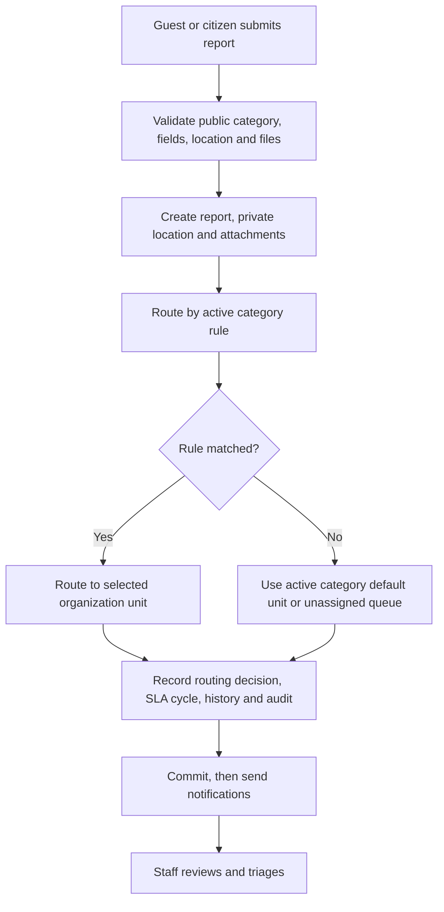

# CivicTrack 3.0 Architecture and Delivery Record

**Reviewed:** 2026-11-23  
**Status:** Core application workflows and the audited security/account/workforce upgrades are implemented; production setup and several requested domains remain.
**Application shape:** Laravel modular monolith, Blade application, one relational data store.

## Repository implementation audit and delivery checklist

The repository audit was completed before implementation changes. The configured local database is SQLite 3.45.2 with 48 tables and all 39 migrations recorded as applied. The migration-status and schema checks were read-only. PHPUnit uses SQLite `:memory:`; the baseline suite passed **68 tests and 461 assertions** on 2026-11-23. The read-only `db:show --counts` command could not render its output because this PHP runtime lacks `intl`; its schema inspection was therefore checked against the applied migration list instead. No live-database migration or seed command was run.

### Existing and working at audit time

- Laravel 13 authentication uses Fortify for registration, password reset, email verification, profile/password updates, rate-limited login, and account suspension checks. Citizen registration is checked against a database control.
- Spatie roles and permissions distinguish administrator, staff, worker, and citizen. Guest reporters use hashed 256-bit tracking tokens. Workforce applications do not grant operational access before approval.
- Staff and worker applications, approval/rejection, application history, separate staff/worker dashboards, profiles, and unit memberships exist. Citizens retain the citizen role when one workforce application is approved.
- Reports can be submitted by guests and citizens, routed by category rule/default, triaged by unit-scoped staff, tracked, commented on, and shown on a public map only after staff publication with generalized coordinates.
- Work orders contain multiple tasks and dependency edges. Workers accept or decline assignments, record progress, upload evidence, and submit work; staff verify or return work. Verified tasks can complete a work order and resolve a report.
- Report SLA policies, per-report snapshots/cycles, elapsed-minute deadlines, escalation jobs, an overlap-protected scheduler entry, reopen requests, service feedback, worker assignment ratings, notifications, and append-only audit events exist.
- At audit time, upload services used the `local` disk rooted at `storage/app/private`; none wrote to the public disk. The delivery below moves writers to a named private disk and centralizes all download checks.
- Seeders use `firstOrCreate` for roles, controls, and categories. `DatabaseSeeder` does not delete or reset records. The administrator bootstrap command takes its credentials from configuration and refuses to modify an existing account with that email.
- Public, citizen, staff, worker, and administrator Blade layouts and dashboards exist. The public map and location picker use Leaflet. Frontend dependencies are already installed; the production build is checked after implementation changes.

### Existing but incomplete at audit time

- Report transitions are spread across triage, comments, task verification, and reopening services. Triage supports review, information requests, rejection, and a duplicate status, but duplicate reports are not linked, merged, or preserved through an explicit merge operation. Cancellation, dispute, escalation review, and a general controlled transition map are absent.
- Report attachments have a boolean `is_public`, but no reporter-versus-internal visibility. Citizen and guest pages currently load every attachment for the report, and their download checks do not distinguish an internal attachment. Download code is repeated across controllers and trusts the disk named by database metadata.
- Task assignment serializes assignment to a task and locks the worker row before checking workload, but the task model exposes one active assignment and the planner accepts one worker at a time. Skills, certifications, service-area eligibility, shifts, availability, assistance requests, and assignment uniqueness constraints are absent.
- Staff and worker profiles are distinct but sparse; staff profile details retain only a position title. There is no profile editing or admin account-management workflow. The bootstrap command only provisions the initial administrator.
- SLA matching, snapshots, pause-free escalation, and idempotent SLA state updates exist, but targets use elapsed minutes. Working calendars, holidays, pauses, configurable escalation rules, and notification outbox/idempotency are absent. Delivery reliability depends on the configured queue/mail provider.
- Citizen communication is limited to append-only report comments and notification center entries. There is no read-tracked message thread, citizen/staff attachment workflow, or internal communication center.
- Category, priority, unit, and service-area matching are limited to the fields currently modeled. Dynamic category forms, duplicate suggestions, merge audit, inventory/resources, worker performance scoring, and sample-size safeguards are absent.
- Registration can be disabled independently for citizens, staff applicants, and worker applicants, but administrative account creation while applications are closed is not implemented in the UI or domain workflow.
- Tests cover primary existing workflows, but there are no private-file authorization matrix tests, seed-repeatability test, concurrent assignment test, or full role/ownership matrix. The Example tests are framework smoke tests.
- `README.md` is the stock Laravel README and does not describe CivicTrack. `docs/architecture.md` contains useful architecture notes but overstates attachment boundaries and some delivery evidence, and records no city/demo data.

### Broken or unsafe at audit time

- A future/internal `report_attachments` row can be displayed and downloaded by a report owner or a guest with tracking access because both reporter-facing paths authorize only the parent report and attachment foreign key. This must be corrected before internal report attachments are introduced.
- The staff evidence download policy also allows an assigned worker to reach the staff URL; that path checks only that the evidence belongs to the task, so it does not bind the evidence to the requesting worker's assignment. The worker-specific URL does bind to the active assignment.
- Private file download handlers can resolve `storage_disk` directly from a database row and do not reject public disks or validate a generated-path prefix. Current upload writers set private `local` paths, but the download boundary should fail closed independently of writer behavior.
- Successful guest-token verification adds a report-access flag without regenerating the session identifier.
- The service-category seed and repository contain no Afghan-context city/administrative demo records, and `DatabaseSeeder` creates no demo accounts or required administrator identity.
- The admin MFA/passkey schema exists, but the configured Fortify feature list does not enable two-factor authentication or passkey login.
- `php artisan db:show --counts` fails in this runtime because `intl` is unavailable; do not interpret this formatting failure as evidence that the database is empty or broken.

### Missing at audit time

- A full report/work-order lifecycle with controlled cancellation, dispute, duplicate linkage and merge, escalation actions, and auditable reopen semantics.
- Relational skills, specializations, certifications, service areas, team membership beyond unit membership, configurable category fields, business calendars/holidays, notification idempotency records, and inventory/resource records.
- Multiple active workers on one task, assignment acceptance/rejection history suitable for that model, assistance requests, and completion verification across multiple contributors.
- A citizen communication center with public/internal threads, read status, and authorized attachment handling; secure account creation and workforce provisioning by administrators.
- Afghan-context demo locations for Kabul, Herat, Kandahar, Mazar-i-Sharif, Jalalabad, Kunduz, Bamyan, Ghazni, and Khost, plus development-only demo accounts with environment-configurable credentials.
- Automated coverage for the required guest/citizen/staff/worker/administrator file-access matrix, application-closed admin provisioning, all role permissions, duplicate workflows, calendars, seed idempotency, and concurrency behavior.

### Proposed changes and current status

1. **Complete — file security:** Private downloads are centralized and record-scoped; reporter/internal visibility, generated-path checks, upload extension/MIME/size validation, guest session regeneration, and file-access tests are in place.
2. **Complete — account provisioning and demo safety:** Admins can provision citizen/staff/worker accounts independently of public application controls. The fixed bootstrap identity uses an environment-only password. Afghan-context units and clearly labeled local demo accounts are opt-in and idempotent.
3. **Partial — lifecycle and communication:** Controlled duplicate suggestions, related-report links, duplicate marking, audit-preserving merge, pre-work cancellation, and reviewable outcome disputes are implemented. Cancellation is blocked once field work is planned. Assistance requests and a read-tracked message center remain.
4. **Partial — database/domain architecture:** Team assignment and team verification are implemented. Skills/certifications, service areas, dynamic category fields, business calendars, notification idempotency records, and resources remain. Back up the target database before applying the pending migrations.
5. **Complete — repeatable tests and documentation updates:** The README and architecture record describe implemented features and current limitations. Seed-repeatability, file-authorization, team-assignment, and application-closed account-provisioning tests have been added.
6. **Partial — full acceptance:** The project test suite and Vite build pass, but complete role matrices, notification retry behavior, browser accessibility, threat-model review, and production-database migration/restore acceptance remain.

### Phase 1 audit findings

| Domain | Audit status | Primary evidence |
|---|---|---|
| Identity and access | Existing foundation; account provisioning and admin MFA incomplete | Fortify configuration, role/permission seeder, policies, route middleware, auth tests |
| Reports and guest tracking | Submission, token tracking, routing and basic triage work; lifecycle/duplicate handling incomplete | Report models/services, routes, submission/triage tests |
| Private files | Upload destinations are private; visibility and download authorization need correction | Filesystem config, upload services, attachment/evidence download handlers |
| Work orders and tasks | Single-worker workflow works; requested multi-worker/eligibility model incomplete | Assignment/verification services, task schema, lifecycle tests |
| SLA and accountability | Elapsed-minute SLA, feedback/reopen and audit work; calendars/idempotent notifications incomplete | SLA service/job/scheduler, feedback services, SLA tests |
| Communication and duplicate handling | Comments/notifications work; message center and controlled duplicate workflow missing | Report comments, notification routes, status enum |
| Seed data and docs | Safe basic seeders; Afghan demo data and accurate README missing | DatabaseSeeder, category/role seeders, README, this architecture record |
| Verification | Existing baseline passes; required privacy/concurrency cases are untested | PHPUnit: 68 passed, 461 assertions |

Phase 1 recorded the baseline before changes. Subsequent delivery notes and current verification evidence appear below; the findings in this initial checklist describe the repository at audit time.

### Delivery after the baseline audit

- **Phase 2 — file security:** Added reporter/internal attachment visibility with a conservative legacy backfill, centralized database-backed private downloads, allowed only private local disks and record-specific generated paths, tightened MIME/extension/size validation, scoped task evidence to its assignment, and regenerated the guest tracking session after token verification.
- **Phase 3 — account provisioning:** Added permission-gated administrator account creation for citizens, staff, and workers. Workforce contexts receive an active unit membership and separate profile in one transaction; no password is exposed, email verification is required for workspace access, and provisioning is audited. Public application controls do not gate this administrator path. The required initial administrator was created only after confirming the configured identity was absent, using the protected bootstrap secret.
- **Phase 4 — team assignments:** Tasks can have multiple active workers. A unique active-worker key prevents duplicate active assignment of the same worker to one task; the task row lock serializes team changes. Workers retain individual accept/decline, update, and evidence history. Staff can replace a team member with a reason, and verification waits for all active workers to submit before applying one team decision.
- **Phase 5 — report lifecycle and duplicates:** Added pre-work reporter cancellation, a bounded dispute window, staff uphold/reopen decisions, and advisory duplicate suggestions with authorized related, duplicate, and merge actions. Status events and audit records preserve the decision trail; reopen starts a new SLA cycle. Guest confirmation and tracking responses now use private no-store cache headers.
- **Seed and documentation safety:** Replaced the stock Laravel README, fixed the bootstrap administrator identity to Farid Ahmad Khan (`farid@civictrack.com`) while keeping its password environment-only, and added opt-in, local/test-only Afghan-context demo units and accounts. Repeated demo seeding does not overwrite existing accounts or delete reports.
- Four additive migrations are present for report attachment visibility, active assignment uniqueness, nullable application links for admin-provisioned profiles, and report relationships. They have been exercised by the in-memory test suite but remain pending on the configured database; none drops or truncates application data. Back up the target database before deployment migration.
- Current verification: **89 tests and 635 assertions passed**; `npm run build` succeeded. The configured database still reports the original 39 migrations as applied and these four new migrations as pending.
- Report relationship rows use foreign keys and a unique canonical target constraint. Related-report pairs use a stable ID order; SQLite triggers reject self-links, invalid relationship types, and noncanonical related pairs. Duplicate marking and merge lock both reports in ID order and keep both reports and their histories; merge does not combine report content.

This record replaces the initial proposal with the architecture now present in the codebase. Automated feature tests use SQLite `:memory:`; they do not migrate or seed the configured application database. The existing `.env` and its credentials are intentionally left untouched. `.env.example` documents safe configuration defaults.

## 1. Runtime and package baseline

The project runs with the portable PHP **8.5.13** runtime and Laravel **13.43.0**. The machine's XAMPP PHP is not the runtime used for project Artisan, Composer, or tests. The configured production database version has not been confirmed; choose a currently maintained MySQL or MariaDB release before deployment.

| Package | Installed version | Use |
|---|---:|---|
| `laravel/framework` | 13.43.0 | Routing, HTTP, Eloquent, queues, notifications, scheduler, policies |
| `laravel/fortify` | 1.43.0 | Session authentication, verification, reset, profile and two-factor flows |
| `spatie/laravel-permission` | 8.5.0 | Role and permission persistence |
| `livewire/livewire` | 4.4.9 | Installed; current screens use Blade controllers and small JavaScript modules |
| `leaflet` | 1.9.4 range in `package.json` | Interactive report location picker and public community map |
| `tailwindcss` | 4.x | Design tokens and utility styling through Vite |
| `vite` | 8.x | Frontend development and production asset build |
| `phpunit/phpunit` | 12.5.45 | Feature workflow tests |

Confirm exact locked JavaScript versions in `package-lock.json` when changing frontend dependencies. Existing packages were selected for this foundation; any new dependency requires review first.

## 2. Application architecture

CivicTrack is a server-rendered modular monolith. Controllers are grouped by access context under `app/Http/Controllers`; Form Requests validate input and authorize entry; Policies and service-level checks enforce record and organization scope; focused services own transactional state changes. Eloquent models express the schema and relationships. Events and listeners deliver after-commit notifications, while queued jobs and the scheduler handle SLA escalation.

```text
app/
  Console/Commands/       # administrator bootstrap and SLA check
  Enums/                  # persisted roles, permissions, and workflow states
  Events/, Listeners/     # after-commit lifecycle notifications
  Http/Controllers/       # Public, Citizen, Staff, Worker, Admin, Account
  Http/Requests/           # validated and authorized inputs
  Jobs/, Notifications/   # queued escalation and user notices
  Models/                 # Eloquent entities and relationships
  Policies/                # report, unit, application, work order, and task access
  Services/                # routing and transactional workflows
database/migrations/       # application, Laravel, and permission schema
resources/views/           # separate role layouts and Blade screens
resources/js/app.js        # Leaflet map and work-order task interactions
routes/web.php             # browser routes and middleware boundaries
routes/console.php         # five-minute SLA schedule
```

There is no public API or mobile client in this delivery. A future API must use explicit versioned routes and the same policies and workflow services.

## 3. Access contexts and organization scope

One verified web account can retain citizen access and separately gain a workforce role. Guest citizens use signed-in-session-free report access codes. Staff and workers are separate persisted roles with separate dashboards and permission sets. Pending applicants receive no operational role.

| Context | Current authorization boundary |
|---|---|
| Guest citizen | Submit a report, then use its random access code to see permitted public history, comment, send eligible feedback, or request reopening. The database stores only the SHA-256 token hash and expiry. |
| Registered citizen | Create and view own reports, post permitted comments, receive account notifications, and use eligible service feedback. Ownership is checked for every report operation. |
| Staff | Active staff membership in the report or work-order unit is required for departmental work. Staff triage, plan tasks, assign workers, review evidence, verify work, review reopen requests, and rate completed assignments. |
| Field worker | May view and update only assigned tasks, submit evidence, and request verification. Workers cannot verify their own work or access staff report functions. |
| Administrator | `platform.access` plus named permissions permits cross-unit administration. Configuration and approval changes are audited. |

Roles and permissions are seeded from `RoleName` and `PermissionName`. Laravel policies and scoped queries remain required; a role name alone does not grant cross-unit record access. Organization units form a parent/child tree. `unit_memberships` preserve membership type, active state, and dates. Approved applications create a staff/worker profile, role, and unit membership in one review transaction. The admin bootstrap command creates a configured administrator only when that identity does not exist; it does not overwrite an existing password.

## 4. Database relationship design

The ER diagram reflects persisted application entities. Laravel sessions, cache, queue tables, database notifications, and Spatie permission tables support the application but are not repeated in the diagram.

```mermaid
erDiagram
    USERS ||--o| CITIZEN_PROFILES : has
    USERS ||--o| STAFF_PROFILES : approved_as
    USERS ||--o| WORKER_PROFILES : approved_as
    USERS ||--o{ WORKFORCE_APPLICATIONS : submits
    WORKFORCE_APPLICATIONS ||--o{ WORKFORCE_APPLICATION_EVENTS : records
    WORKFORCE_APPLICATIONS ||--o{ WORKFORCE_APPLICATION_DOCUMENTS : includes
    USERS ||--o{ UNIT_MEMBERSHIPS : joins
    ORGANIZATION_UNITS ||--o{ ORGANIZATION_UNITS : contains
    ORGANIZATION_UNITS ||--o{ UNIT_MEMBERSHIPS : includes

    ORGANIZATION_UNITS ||--o{ SERVICE_CATEGORIES : default_unit
    SERVICE_CATEGORIES ||--o{ SERVICE_CATEGORIES : parent
    SERVICE_CATEGORIES ||--o{ ROUTING_RULES : selects
    ORGANIZATION_UNITS ||--o{ ROUTING_RULES : receives
    USERS o|--o{ CIVIC_REPORTS : reports
    SERVICE_CATEGORIES ||--o{ CIVIC_REPORTS : classifies
    ORGANIZATION_UNITS o|--o{ CIVIC_REPORTS : routes
    USERS o|--o{ CIVIC_REPORTS : assigned_staff
    CIVIC_REPORTS ||--o| REPORT_LOCATIONS : locates
    CIVIC_REPORTS ||--o{ GUEST_ACCESS_TOKENS : grants
    CIVIC_REPORTS ||--o{ REPORT_STATUS_EVENTS : tracks
    CIVIC_REPORTS ||--o{ REPORT_COMMENTS : discusses
    CIVIC_REPORTS ||--o{ REPORT_ATTACHMENTS : supports
    CIVIC_REPORTS ||--o{ ROUTING_DECISIONS : records

    CIVIC_REPORTS ||--o{ WORK_ORDERS : creates
    ORGANIZATION_UNITS ||--o{ WORK_ORDERS : manages
    WORK_ORDERS ||--o{ WORK_TASKS : contains
    WORK_TASKS ||--o{ TASK_DEPENDENCIES : depends
    WORK_TASKS ||--o{ TASK_ASSIGNMENTS : assigns
    USERS ||--o{ TASK_ASSIGNMENTS : worker
    TASK_ASSIGNMENTS ||--o{ TASK_UPDATES : records
    TASK_ASSIGNMENTS ||--o{ TASK_EVIDENCE : submits
    TASK_ASSIGNMENTS ||--o{ TASK_VERIFICATIONS : reviewed
    TASK_ASSIGNMENTS ||--o| WORKER_RATINGS : rated

    REPORT_SLA_POLICIES o|--o{ REPORT_SLA_INSTANCES : snapshots
    CIVIC_REPORTS ||--o{ REPORT_SLA_INSTANCES : cycles
    REPORT_SLA_INSTANCES ||--o{ SLA_EVENTS : records
    CIVIC_REPORTS ||--o| SERVICE_FEEDBACK : receives
    CIVIC_REPORTS ||--o{ REPORT_REOPEN_REQUESTS : receives
    USERS o|--o{ AUDIT_EVENTS : acts
```



Important constraints and history records:

- A report has one location row, a unique public reference, an optional citizen owner, and a current routed unit. Status transitions, routing decisions, comments, and SLA events are separate records.
- A report may have multiple work orders and tasks. Task dependency pairs are unique and self-dependency is rejected; the work-order service rejects dependency cycles. Task evidence and verification point to the relevant assignment.
- A report has at most one service feedback row. A completed task assignment has at most one worker rating. A report may have multiple SLA cycles, uniquely numbered per report, and multiple reopen requests over its lifetime.
- SLA policy and name/version/target snapshots make existing report deadlines independent from future policy edits. No matching policy is represented as `not_applicable`, without invented deadlines.
- Guest tokens are stored as hashes. Guest email is encrypted at rest by an Eloquent cast. Private uploads use generated storage paths and are served through scoped download routes.
- `audit_events` store actor, polymorphic subject, action, properties, request metadata, and timestamp. Workflow history tables are append-only through application paths; administrative changes also write audit events.

## 5. Report submission and routing lifecycle

Registered citizens and guests share the same category, location, description, upload, routing, triage, and SLA handling. Public submission checks category availability again inside the transaction. Guest submissions receive an unguessable access code; the code is shown once and is required for protected tracking actions. Submission, initial status history, routing decision, SLA snapshot, token, and audit record are committed together. Uploads are removed if the database transaction fails.



The current routing engine chooses the highest-priority active rule for the category, then an active category default, then the unassigned triage queue. It records the reason and destination. Geographic polygons, service-area boundaries, keyword/AI classification, and configurable field schemas are not implemented; routing is category based.

Current report statuses are `submitted`, `under_review`, `needs_information`, `acknowledged`, `in_progress`, `resolved`, `closed`, `reopened`, `rejected`, `duplicate`, `cancelled`, and `disputed`. Triage accepts submitted, under-review, or reopened reports and can move them into under-review, acknowledged, information-requested, or rejected. Reporters can cancel before field work is planned. They can dispute a closed outcome within the configured review window; staff can uphold the prior outcome or reopen the report, which starts a new SLA cycle. Dispute submission hides a published report while review is pending. Duplicate suggestions compare recent reports in the same category by title and location; they never change status automatically. Staff can link related reports or mark a report duplicate/merge it into a canonical report only when authorized for both records. The relation, reason, actor, report status event, and audit event are retained. A merge keeps both report rows and both histories; it does not transfer or combine comments, attachments, or work orders. Acknowledged reports can move into field work; verified completion resolves a report only when every required task is verified. Rejected, duplicate, and cancelled outcomes close the associated SLA cycle.

## 6. Workforce application and task lifecycle

Staff and worker applications are separate application types and review permissions. Applicants can submit information and private documents, view their own application history, and answer information requests. Review decisions use a transaction to append an application event, record the reviewer, and—on approval—create the corresponding profile, active unit membership, and distinct `staff` or `worker` role. Rejection leaves no active operational membership. New applicants receive status notifications.

For an acknowledged report, authorized staff create one or more work orders containing tasks and dependencies. Each work order is scoped to the routed unit. Staff assign eligible active unit workers, subject to a configurable active-task limit. Workers accept or decline assignments, start work, append progress updates, upload evidence, and submit the task for review. Staff can verify completion or return it with a required correction reason. All state changes are transactional and audited. There are no worker skill/certification records, route optimization, shift calendars, or task-level SLA timers in this version.

Task states: `queued` → `assigned` → `in_progress` → `submitted_for_review` → `completed`, with `needs_rework` and `cancelled` paths. Assignment states independently track `assigned`, `accepted`, `in_progress`, `submitted`, `needs_rework`, `completed`, `declined`, and `reassigned`. A work order completes when its tasks are verified; a report resolves only when all its tasks across work orders are complete. The implementation caps task creation at 25 per work order.

## 7. SLA, notification, and scheduling architecture

Administrators maintain versioned report-SLA policies with optional category, unit, and priority scopes, effective/expiry dates, first-response and resolution targets, and repeat-escalation intervals. At submission, the service selects the most specific matching active policy, then the most recent version. The new SLA instance freezes the effective policy values. If none applies, it creates a truthful `not_applicable` cycle.

The first-response target is recorded at staff triage. Resolution is recorded when the report is closed without work or after all required work is verified. Reopening a resolved report starts a new numbered SLA cycle. A unique queued `EscalateReportSla` job locks the cycle, records newly breached targets and escalation history, audits the event, then queues notifications to active administrators and active staff in the routed unit. The job is idempotent under retry.

`civictrack:sla:check` is scheduled every five minutes with overlap prevention. Production must run Laravel's scheduler and a queue worker. The current `.env.example` uses database queues and log mail; mail delivery is not configured by this repository default. SLA durations currently use elapsed minutes; business-hour calendars, holidays, and unit-specific work schedules are not implemented.

Fortify and application events provide authentication and lifecycle notices. The account notification center lists the authenticated user's database notifications and supports marking one or all read. Notifications link to the appropriate report, workforce application, assigned task, or SLA queue. External SMS/push delivery and provider configuration are not included.

## 8. Feedback, reopening, mapping, and audit

After resolution, the report owner or guest with valid report access can leave one 1–5 service rating and optional comment. Within the configurable reopen window (default 30 days), that reporter may request reopening. Authorized staff in the routed unit approve or reject; rejection requires a reason. Approval records history and audit, returns the report to `reopened`, and starts a fresh SLA cycle. Staff may rate each completed and verified worker assignment once for quality, safety, and professionalism; self-rating and cross-unit rating are rejected.

Leaflet powers the report-location picker and public community map. Street tiles default to the canonical OpenStreetMap tile URL; optional satellite imagery uses Esri World Imagery raster tiles. Both layers have visible provider attribution, and the satellite control reports loading and falls back to streets when no tile arrives. Tile providers receive the browser's tile requests and network metadata, so the deployment privacy notice must identify the configured providers. OpenStreetMap tiles have no service-level guarantee and may block traffic that violates their policy. Esri's no-charge service terms are limited to non-commercial use and allow changes or discontinuation. Esri's current web terms classify government use as commercial services, so government deployments need the appropriate written agreement or another licensed provider. Confirm the deploying organization's eligibility and terms before launch.

Place search defaults to OpenStreetMap Nominatim. Search is initiated by the user, sends only the typed place query to CivicTrack, and never reads or submits report location fields. The server identifies the app in its provider request, applies a one-request-per-second shared limit, and caches results. There is no autocomplete. A report map previews a selected result and updates its coordinates and address only after confirmation; the public map only pans to the result. Search results are validated before being returned. The provider is configurable or can be disabled, and searches are unavailable when the endpoint is missing or invalid. Nominatim's public service permits moderate user-triggered use under its policy, requires attribution, and must not receive confidential data; configure a switchable endpoint or a dedicated provider before traffic exceeds those limits.

Reports are private by default. Staff triage explicitly controls public listing. A published report receives rounded generalized coordinates and `generalized_public` privacy state; removing publication clears public coordinates. The map query requires both staff publication and generalized coordinates, allows only approved statuses, caps results at 500, and sends only category, status, and generalized coordinates to the browser. It never renders exact coordinates, address, report title, reference, contact details, or attachments. The default map center is `(0, 0)` and must be set for the deployment area.

The admin audit view supports filtering by action, actor, and date. Workflow services use `AuditWriter` inside the transaction that changes state. Audit records include request metadata; access is limited to the audit permission. Citizen, staff, worker, and admin layouts are separate, and their dashboards use database queries for reports, workload, applications, SLA state, reopen queue, and ratings.

## 9. Design system and user experiences

The interface uses a shared tokenized Tailwind palette, typography scale, spacing, focus states, buttons, forms, badges, and card treatments. Blade layouts separate public, citizen, staff, worker, administrator, and authentication experiences. Public pages focus on service discovery, privacy, report submission, and transparent published activity. Citizen pages focus on their reports and updates. Staff pages focus on triage queues, workload, SLA, and work planning. Worker pages focus on assigned tasks, updates, and evidence. Administrator pages focus on configuration, applications, audit, and cross-service measures.

Leaflet controls are keyboard-accessible around the map and retain direct form fields for coordinates. Place search supports keyboard submission, loading, empty, error, and rate-limit feedback, with confirmation before report coordinates change. Automated tests cover server-side privacy and workflow boundaries. A formal screen-reader, keyboard-only, contrast, and real-device review is still required before public launch.

## 10. Implementation phases and current acceptance evidence

| Phase | Delivered scope | Current evidence |
|---|---|---|
| 1. Foundation and identity | Laravel 13, Fortify, roles/permissions, account lifecycle, registration controls, safe admin bootstrap and privileged account provisioning | Auth, registration, suspension, bootstrap and admin provisioning feature tests |
| 2. Organization and workforce | Unit hierarchy, staff/worker applications, scoped memberships, private application documents | Application and organization feature tests |
| 3. Citizen reports | Guest/citizen intake, private uploads, tracking token, routing, triage, comments and history | Report submission and triage feature tests |
| 4. Field operations | Work orders, task dependencies, multiple worker assignments, per-worker updates/evidence, and team verification | Work-order task lifecycle, assignment uniqueness and private evidence tests |
| 5. Accountability | Report SLA policies/cycles/escalations, citizen feedback, reopening, worker ratings, audit trail | SLA, feedback/reopen, worker-rating, audit and notification feature tests |
| 6. Separate workspaces and transparency | Public/citizen/staff/worker/admin layouts, dashboards, notification center, generalized public map | Dashboard, notification and community map feature tests; Vite production build |
| 7. Release readiness | Deployment secrets/providers, production DB and queue, retention/backup, abuse limits, accessibility and operational review | Not complete; must be configured and validated for the target deployment |

Tests run with PHPUnit and the test configuration forces SQLite `:memory:`, array cache, and synchronous queue dispatch. This protects the configured database from test migrations. Do not run `migrate:fresh`, database wipes, or seed commands against the configured application database. The three migrations added in this work have not been applied to the configured database.

## 11. Remaining work before production

1. Confirm and provision a supported production PHP/database release, secure secret storage, HTTPS, session settings, backups, and restore procedures.
2. Configure a production mail provider, queue worker, scheduler invocation, failed-job monitoring, and notification delivery checks.
3. Set the deployment's map center. Confirm Esri's current licensing terms and organizational eligibility, and select tile and geocoding providers appropriate to expected traffic. The public OSM tile and Nominatim services have usage limits and no CivicTrack service-level guarantee.
4. Agree on public-report retention and moderation, privacy notice/legal basis, guest abuse controls, upload retention, data access and deletion procedures, and incident response.
5. Add operational policy only when approved: business-hour SLAs, service boundaries, category-specific forms, worker skills/certifications, staffing/availability, and any additional channels.
6. Perform browser-based accessibility, responsive, performance, threat-model, and deployment acceptance reviews. The passing automated workflows do not replace these reviews.

